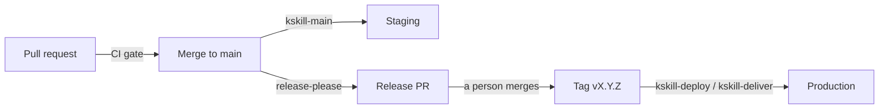

<!-- This Source Code Form is subject to the terms of the Mozilla Public License, v. 2.0. If a copy of the MPL was
     not distributed with this file, You can obtain one at https://mozilla.org/MPL/2.0/. -->

<div align="center">

# kheona-skill

**Shared CI, releases, delivery and repository automation for GitHub — built to work the same on GitHub Free.**

[](https://github.com/GuillaumeDerivery/kheona-skill/actions/workflows/ci.yml)
[](https://github.com/GuillaumeDerivery/kheona-skill/releases)
[](https://scorecard.dev/viewer/?uri=github.com/GuillaumeDerivery/kheona-skill)
[](LICENSE)

[Get started](#-get-started) · [What you get](#-what-you-get) · [How a release flows](#-how-a-release-flows) · [Contributing](#-join-in)

</div>

---

👋 **Welcome!** Maintaining a pipeline in every repository is tedious, and each copy slowly drifts. kheona-skill
keeps all of it in one place. A repository keeps a few small caller files and one `.kheona.json`; everything else
lives here, pinned by commit, and moves forward through a single Renovate PR per release.

It's opinionated where it saves you work, and plain where you need to read it: every workflow is ordinary
GitHub Actions YAML, every script is Bash or Node, and nothing runs that you can't open and read.

## ✨ What you get

| | |
|---|---|
| 🧪 **CI for every stack** | Node, Python, Flutter, Terraform and cluster manifests: one gate per pull request. The shared workflow reads the stack from your files and `.kheona.json`, so a caller never names it. |
| 🚀 **Deploys** | Build, push and roll out to EKS by image digest, then read back what actually runs. Or hand over to your own deploy workflow. |
| 🏷️ **Releases a person decides** | release-please keeps a release PR open; merging it creates the version tag, and the tag ships to production. |
| 📱 **Flutter delivery** | TestFlight and Google Play from one workflow. |
| 🔎 **Sentry triage** | Production errors become issues, and fixes. |
| 🔄 **Renovate** | Self-hosted, with shared presets: one update PR a week, one lock file PR, a security PR at once. |
| 🤖 **Claude review and `@claude`** | A review on automation PRs, and fixes when you ask. |
| 🔐 **No App key in any repository** | A small token broker swaps a job's OIDC identity for a short-lived GitHub App token. |

## 🚀 Get started

Adoption takes about five minutes per repository. The full guide is [docs/adoption.md](docs/adoption.md).

1. **Once per owner:** create your GitHub App and deploy the token broker ([terraform/token-broker](terraform/token-broker/README.md)).
2. **Per repository:** run the setup command. It checks each step, does what it can, and walks you through the rest:

   ```bash
   scripts/kskill-setup.sh --apply owner/repo ../my-repo
   ```

   It covers `.kheona.json`, the topic, the App installation, release files, callers and `renovate.json`,
   settings, variables and secrets by name. For an app's store secrets it explains each one, where to find it,
   and the exact `gh secret set` command; it never reads a value. It finishes by opening the PR that proves it
   all works. Safe to re-run: it resumes where it stopped.
3. **Merge that PR.** From then on, kheona-skill updates arrive as one Renovate PR per release.

Prefer to write the callers yourself?

```bash
node scripts/kskill-callers.mjs write --repo ../my-repo --self owner/kheona-skill --sha <40-hex-commit> --version v2.0.0
```

## 🧭 How a release flows



| When | Workflow in the repository | What happens |
|---|---|---|
| A PR is opened or updated | `kskill-pr.yml` | CI. Nothing deploys. |
| A merge to `main` | `kskill-main.yml` | CI, then **staging** (a service; an app has none). |
| A merge to `main` | `kskill-release-please.yml` | release-please opens or updates the release PR: version and CHANGELOG, with a "Check before you merge" list. |
| **A person merges the release PR** | `kskill-release-please.yml` | The version tag `vX.Y.Z` and the GitHub release, made with the App token. |
| The tag is pushed | `kskill-deploy.yml` or `kskill-deliver.yml` | The release check, then **production**: a service runs the image staging tested (the release commit changes only versions; `APP_VERSION` is set at deploy), else the full gate and a build. An app is built (TestFlight and Play). |
| Started by hand on an earlier tag | the same | A rollback: the release's own image when ECR still holds it. An app fixes forward. |
| **In a fork, a person publishes a release** (the parent's version, on `main`) | the same | The release check, the full gate, then **production**. Release-please never runs in a fork. |
| Started by hand on `main` (an app) | `kskill-deliver.yml` | A test build, no version. |

<details>
<summary><b>The guarantees behind it</b></summary>

- **The environment comes from the ref, never from an input:** `main` is staging, a version tag is production, nothing else deploys (`.github/scripts/kskill-release-check.sh`).
- **A tag deploys only a person's release:** `vMAJOR.MINOR.PATCH`, on `main`, the newest, the squash merge of release-please's PR merged by a person with write access, and Main passed on the commit before it (still running: the check waits for it, up to 45 minutes). The release PR runs the gate like any PR, and its checklist names a submodule's versions and calls out a major one. A rollback, and a fork's release, need a published release and a person with write access. Tags cannot be protected on every plan, so the workflow checks.
- **A library** releases itself: its release PR merges once its gate passed (`workflows.releasePlease.merge`); the tag deploys nothing.
- **Production callers pin this repository by its immutable version tag**, so an AWS role can trust only those versions: `token.actions.githubusercontent.com:job_workflow_ref` like `<owner>/kheona-skill/.github/workflows/kskill-deploy.yml@refs/tags/v2.*`, with `sub` `repo:<owner>/<repo>:ref:refs/tags/v*`. Prove the exact value with a dry run before tightening a trust policy.
- **A custom deploy:** `workflows.cd.target: "custom"`. The release check and the gate stay here; the repository's own workflow (`workflows.cd.custom.workflow`, default `deploy.yml`, `on: workflow_call` with the inputs `environment` and `version`) deploys, with its own credentials.
- **This repository** releases the same way (`release.yml`): a person merges its release PR, the release is immutable, and each repository gets it through one Renovate PR that moves its callers, its preset pin and, in a Node repository, its `kheona-skill` devDependency together. Renovate's post-upgrade step then writes the callers again with the generator of the new version (`scripts/kskill-callers-regenerate.mjs`), so a caller whose content changes arrives right in that PR. That step is the running Renovate workflow's, so its caller must be on a version that has it (v2.7.0 on); a run behind the latest release warns.

</details>

## 🔐 Secrets, safely

Four places hold secrets, and only the token broker holds the GitHub App key. Values are never printed and never
reach a public log; a caller passes each secret by name. Set only what a repository uses: a missing required secret
fails with its name before any real work starts, and a missing optional one just turns its feature off.

Every secret and variable, where it lives and what reads it: **[docs/secrets.md](docs/secrets.md)**.

## 🧠 Use it as a Claude Code skill

The repository is also the `kheona` skill (`SKILL.md`, `stacks/`, the `enforce.sh` hooks), so Claude Code holds a
repository to the same bar the workflows check:

```bash
git clone https://github.com/<owner>/kheona-skill ~/.claude/skills/kheona
```

`/kheona` audits a repository, lands the mechanical fixes, files an issue for each failure left and reports;
`/kheona report` only reports.

## 📚 Reference

| | |
|---|---|
| [docs/adoption.md](docs/adoption.md) | Adopting it, step by step |
| [docs/kheona-json.md](docs/kheona-json.md) | Every `.kheona.json` key |
| [docs/secrets.md](docs/secrets.md) | Every secret and variable |
| [docs/free-plan.md](docs/free-plan.md) | The GitHub Free limits this is built for |
| [terraform/token-broker/README.md](terraform/token-broker/README.md) | The token broker |
| [CHANGELOG.md](CHANGELOG.md) | What changed in each release |

## 🤝 Join in

You're very welcome here, whether you're trying it on one repository, fixing a typo, or proposing a whole new stack.

- **Questions, ideas and bugs:** [open an issue](https://github.com/GuillaumeDerivery/kheona-skill/issues/new/choose). A short first line that says it all helps us help you.
- **Pull requests:** see [CONTRIBUTING.md](CONTRIBUTING.md). Run `bash test/run-all.sh` before you push.
- **Be kind:** we follow the [Contributor Covenant](CODE_OF_CONDUCT.md).
- **Security:** please report a vulnerability privately, as [SECURITY.md](SECURITY.md) explains, never in a public issue.

If kheona-skill saves you time, a ⭐ helps others find it.

## 📄 License

[MPL-2.0](LICENSE). Use it in private repositories freely; changes to these files are shared back.
